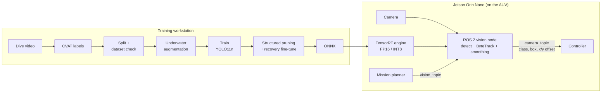
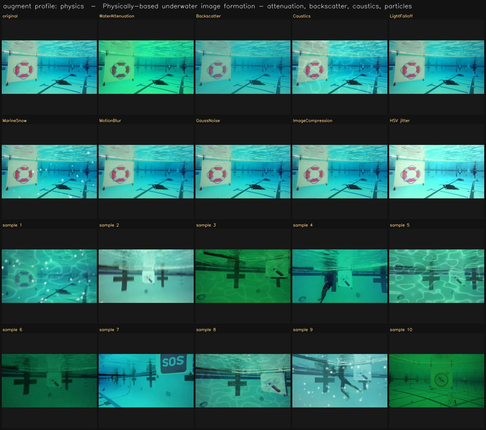

# BRACU Duburi — AUV Vision Pipeline

[](https://github.com/MadLad10/BRACU-Duburi-AUV-Vision-Pipeline/actions/workflows/ci.yml)

The complete perception stack of BRACU Duburi's autonomous underwater vehicle at **RoboSub
2026**. It goes from raw dive video to a pruned, TensorRT-compiled detector, and then to a
ROS 2 node that detects and tracks competition targets in real time on a **Jetson Orin Nano**
and feeds steering offsets to the controller.

**Highlights**

- **0.995 mAP50 / up to 0.968 mAP50-95** on gate and torpedo targets, with models fine-tuned
  on footage from the competition pool in California ([results](#results-robosub-competition-testing-california)).
- **Physics-based underwater augmentation.** Five custom transforms each reproduce one effect
  of how underwater images form: colour absorption, backscatter, caustics, light falloff and
  marine snow. Ordinary colour jitter covers none of these.
- **Structured pruning that actually holds.** Whole channels are removed with dependency-graph
  pruning, so the network really gets smaller and faster on TensorRT. This also fixes a silent
  Ultralytics behaviour that rebuilt pruned models at full size during fine-tuning.
- **Detection + ByteTrack tracking on the vehicle.** Each target keeps a stable ID across
  frames, and its box is smoothed over time, so the controller gets steady steering offsets
  instead of frame-to-frame jitter.
- **TensorRT FP16 / INT8 deployment** on a 2.59M-parameter YOLO11n, sized to share the Jetson
  with tracking, control and mission software.
- **One CLI, config-driven, tested.** Every stage is one command driven by YAML presets. Each
  run checks the dataset first and writes a reproducible summary. Unit tests run in CI on
  every push.

---

## Architecture



| Stage | Command | What happens |
|---|---|---|
| Dataset check | `python -m auv_pipeline check` | Finds missing labels, out-of-range class ids, broken boxes and empty classes, and prints per-class counts. Fails fast, before any GPU time |
| Augmentation | `python -m auv_pipeline augment` | Renders a preview of what the model will see, using the exact transforms used in training |
| Training | `python -m auv_pipeline train` | Preset-driven Ultralytics training with underwater augmentation, then held-out test-set scoring and a JSON run summary |
| Pruning | `python -m auv_pipeline prune` | Structured channel pruning plus recovery fine-tuning, one-shot or iterative |
| Export | `python -m auv_pipeline export` | ONNX, plus a TensorRT engine in FP16 or calibrated INT8 |
| Benchmark | `python -m auv_pipeline benchmark` | mAP, params, GMACs, file size, latency and FPS side by side, with deltas against a reference model |
| Everything | `python -m auv_pipeline run` | All of the above, end to end |

---

## 1. Underwater augmentation

Underwater footage degrades in physically predictable ways. Each custom transform reproduces
one of them:

| Transform | Physical effect it reproduces |
|---|---|
| `WaterAttenuation` | Water absorbs red light within metres, then green, so far objects turn blue-green (Beer–Lambert law, with clear / coastal / turbid water types and camera auto-exposure) |
| `Backscatter` | Light scattered by suspended particles lays an uneven haze over the scene |
| `Caustics` | Rippling sunlight patterns on the pool floor and on props, which RoboSub's shallow pool has a lot of |
| `LightFalloff` | The AUV's own lights leave a bright centre and dark corners |
| `MarineSnow` | Out-of-focus bright specks from particles close to the camera |

The **`physics`** profile adds motion blur, low-light sensor noise and video-stream compression
on top. Top rows below: each transform on its own. Bottom rows: random combinations at their
training probabilities, which is exactly what the model sees during training.



Engineering details:
- The transforms reach Ultralytics through its native `augmentations=` training argument,
  with no monkey-patching, so Ultralytics upgrades don't break them.
- They are pixel-only, so the bounding boxes are never disturbed.
- They work in the BGR order Ultralytics actually feeds them, are seeded for reproducibility,
  and are picklable for multi-worker data loading.

Profiles live in [`configs/augment/underwater.yaml`](configs/augment/underwater.yaml). The
team's earlier recipes are kept there as `strong`, `blur` and `light`, plus `none` as an
ablation baseline.

## 2. Training

Presets in [`configs/train/`](configs/train/) define the model, schedule, augmentation and
export targets:

| Preset | Model | Role |
|---|---|---|
| `yolo11n` | YOLO11n, 2.59M params | The model deployed at RoboSub |
| `yolo26n` | YOLO26n | Next-generation nano model, same deployment budget |
| `yolo26m` | YOLO26m | Accuracy ceiling, and the starting point for pruning down to nano size |

Settings are applied in a fixed order, and later ones win: shared defaults, then the preset,
then the augmentation profile, then tuned hyperparameters (`--hyp`), then CLI flags, then
`--set key=value`. A run can be resumed, and `--dry-run` checks everything without training.

Task models are fine-tuned from the previous model for the same task rather than trained from
scratch. That is how the competition models were adapted to the California pool within days.

## 3. Structured pruning

A trained detector carries channels that contribute almost nothing. Pruning removes them so
the deployed network is smaller and faster.

- **Structured, not sparse.** Whole convolution channels are removed, so the network itself
  shrinks. TensorRT gains nothing from unstructured weight sparsity, but it does speed up on a
  genuinely smaller network.
- **Dependency-graph pruning** ([Torch-Pruning](https://github.com/VainF/Torch-Pruning)). When
  a channel is removed, every layer connected to it is updated together, so the network stays
  valid through residual connections and concatenations.
- **BatchNorm-scale importance.** Channels whose BatchNorm scale (γ) is smallest are removed
  first. These are the channels the network has already learned to switch off.
- **The detection head is protected**, so the output format the tracker depends on never changes.
- **Channel counts are rounded to multiples of 8** to match the Tensor Core layout on the
  Jetson's GPU.
- **Recovery fine-tuning** runs at a learning rate 10–20× lower than training, so accuracy lost
  in pruning is regained. It can reuse the training augmentation (`--augment`), which the
  end-to-end `run` command does automatically.
- **One-shot or iterative.** One round (for example 30% of channels) suits a nano model.
  Several prune-and-fine-tune rounds (for example 2 × 40%) take a medium model down to nano
  size while keeping more of its accuracy than one big cut would.

```bash
python -m auv_pipeline prune --weights best.pt --data data.yaml --ratio 0.3 --finetune-epochs 25
python -m auv_pipeline prune --weights yolo26m_best.pt --data data.yaml --rounds 2 --ratio 0.4
```

> **A bug we found and fixed.** Ultralytics' `model.train()` rebuilds the network from its
> original architecture file and copies in only the weights whose shapes still match. With our
> earlier scripts, every "pruned" model was therefore fine-tuned at **full size**, and the
> pruning was thrown away without any error. The pipeline now fine-tunes the pruned network
> itself through a custom trainer, re-measures the parameter count afterwards, and warns if
> the model ever grows back.

Each round prints parameters and GMACs before and after. To measure the accuracy and speed
trade-off, benchmark the original against the pruned model:

```bash
python -m auv_pipeline benchmark --models best.pt pruned.pt pruned.engine \
    --labels original pruned pruned-trt --data data.yaml --save benchmark.md
```

## 4. TensorRT deployment

- Models are exported to **ONNX** and compiled into a **TensorRT engine** in FP16, or in
  **INT8** calibrated on the training images for a further speed-up.
- Engines are built on the Jetson itself, because a TensorRT engine only runs on the TensorRT
  version that built it.
- On machines without CUDA, the exporter skips the engine and prints the exact command to run
  on the Jetson.

```bash
python3 -m auv_pipeline export --weights best.pt --formats engine                         # FP16
python3 -m auv_pipeline export --weights best.pt --formats engine --int8 --data data.yaml # INT8
```

## 5. Real-time detection and tracking (ROS 2)

Detection alone gives a fresh, unrelated set of boxes every frame. Underwater, confidence
drops whenever turbidity, glare or motion blur hits, so detections flicker. Steering towards a
flickering box makes the vehicle twitch. The vision node solves this in two layers:

**ByteTrack** links each detection to an existing track using a Kalman-filter motion model:

- **High-confidence detections are matched first.** These are the clear sightings.
- **Low-confidence detections get a second pass.** A target that is briefly hazy or blurred is
  matched instead of being thrown away. This is exactly the failure mode of underwater
  footage, and it is why ByteTrack was chosen over trackers that discard weak detections.
- **Each target keeps the same ID** through short drop-outs.

**Temporal box smoothing.** Each tracked box is passed through an exponential moving average,
keyed by its track ID. The steering offsets sent to the controller therefore change smoothly
instead of jumping with every frame.

### On-vehicle models

| Mission task | Detector | Classes | Tracker |
|---|---|---|---|
| Gate | YOLO11n, fine-tuned at RoboSub | rescue, repair | ByteTrack + EMA smoothing |
| Torpedo | YOLO11n, fine-tuned at RoboSub | torpedo, blood, hole | ByteTrack + EMA smoothing |

Weights are a launch parameter, so any of these, as `.pt` or as a TensorRT `.engine`, can be
swapped in without code changes. The node's default is the team's earlier medium-size
gate-and-flare model (`gate_flare_medium_100ep`).

### ROS 2 interface

| Topic | Direction | Message | Content |
|---|---|---|---|
| `vision_topic` | in | `custom_interfaces/CameraMsg` | What the mission wants now: `camera` (front / down / grabber) and `model` |
| `camera_topic` | out | `custom_interfaces/CameraMsg` | One message per tracked object: `class_name`, `conf`, smoothed box `x1 y1 x2 y2`, centre `cx cy`, size, and **`x_diff`, `y_diff`**, the target's offset from the frame centre, which the controller steers on |

```bash
ros2 run simulator vision_node --ros-args \
    -p gate_weights:=/path/to/gate.engine -p conf:=0.8 -p tracker:=bytetrack.yaml
```

The same ByteTrack tracking and box smoothing run off-vehicle in [`infer_auv.py`](infer_auv.py)
on recorded dives. It can also inpaint glare-washed or too-dark patches before detection, and show raw
and inpainted results side by side.

---

## Results: RoboSub Competition Testing, California

These models were fine-tuned on footage recorded in the competition pool during the RoboSub
testing days in California. Each score is measured on that model's own validation set:
images from the same dives, held out from training.

- **Precision** is how many detections were correct.
- **Recall** is how many real objects were found.
- **mAP50** is detection accuracy when a box only needs a rough overlap with the real object.
- **mAP50-95** is detection accuracy averaged over looser to very tight box fits. This is the strictest score.

| Task | Classes | Model | Date | Precision | Recall | mAP50 | mAP50-95 |
|---|---|---|---|---|---|---|---|
| **Gate** | rescue, repair | YOLO11n | 11 Jul | 0.990 | 1.000 | 0.995 | 0.968 |
| **Torpedo** | torpedo, blood, hole | YOLO11n | 11 Jul | 0.977 | 1.000 | 0.994 | 0.940 |
| **Torpedo** (updated) | torpedo, blood, hole | YOLO11n | 13 Jul | 0.983 | 1.000 | 0.995 | 0.924 |

All three models found every object in their validation sets (recall 1.000), and at least 97.7%
of their detections were correct. They also scored 0.92–0.97 on the strict mAP50-95 measure.
The validation sets are small and come from the same pool sessions as the training data, so
expect somewhat lower scores in new water or lighting.

Any score can be read back from the weights file with `python -m auv_pipeline report best.pt`.

---

## Engineering notes

Problems found in the previous scripts and fixed in this pipeline:

| Problem | Effect | Fix |
|---|---|---|
| Ultralytics rebuilt pruned models at full size during fine-tuning | Pruning silently did nothing | Custom trainer keeps the pruned network, and the parameter count is checked afterwards |
| Hard-coded training settings overrode the output of `tune_yolo.py` | Hyperparameter tuning had no effect | Explicit precedence: tuned values win over the preset |
| Fine-tuning used Ultralytics' automatic optimizer choice | The low fine-tuning learning rate was ignored | AdamW set explicitly |
| Export looked for `best.pt` at a reconstructed path | When Ultralytics renamed a run folder, export was skipped | The trainer's real save directory is used |
| Vision node kept publishing the last detections after the mission switched model | The controller could steer on stale targets | Detections are published only from the current frame |

---

## Repository layout

```
auv_pipeline/                 the pipeline CLI (python -m auv_pipeline <stage>)
  augment/underwater.py         physics-based underwater transforms
  augment/preview.py            augmentation preview renderer
  dataset.py                    dataset check
  train.py  prune.py  export.py  benchmark.py  results.py  cli.py
configs/
  augment/underwater.yaml       augmentation profiles
  train/*.yaml                  training presets
ros2/
  duburi_vision/vision_node.py  on-vehicle detection + ByteTrack node
  custom_interfaces/msg/        CameraMsg definition
infer_auv.py                  tracking on recorded dives (+ optional inpainting)
split_video.py  split_dataset.py  prepare_dataset.py  tune_yolo.py    data preparation and tuning
saved_runs/                   training curves, confusion matrices, sample predictions
tests/                        unit tests (no GPU needed), run in CI
```

## Quick start

```bash
python3 -m venv .venv && source .venv/bin/activate
pip install torch torchvision --index-url https://download.pytorch.org/whl/cu121   # pick your CUDA version
pip install -r requirements.txt

python split_dataset.py --input /path/to/cvat_export --output /path/to/dataset
python -m auv_pipeline train --data /path/to/dataset/data.yaml --preset yolo11n --augment physics --dry-run
python -m auv_pipeline run   --data /path/to/dataset/data.yaml --preset yolo11n --augment physics --device 0
```
