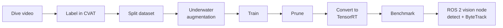

# BRACU Duburi — AUV Vision Pipeline

[](https://github.com/MadLad10/Testing-yolo26/actions/workflows/ci.yml)

This is the vision system for BRACU Duburi's autonomous underwater vehicle (AUV) at RoboSub.
It covers the whole path from raw dive video to a small, fast object detector running on the
vehicle's Jetson Orin Nano, plus the ROS 2 node that detects and tracks targets live and tells
the controller where they are.

---

## How the pipeline works



1. **Collect and label data.** Frames are pulled from dive videos (`split_video.py`) and labelled in CVAT.
2. **Split the dataset.** `split_dataset.py` merges one or more CVAT exports and splits them into training (85%), validation (5%) and test (10%) sets, writing the `data.yaml` that training needs. A dataset check then catches broken labels before any GPU time is spent.
3. **Underwater augmentation.** During training, every image is randomly altered to look like it was taken in different water. Colours fade with depth, the water gets hazier, light ripples on the floor, particles float past, and the camera shakes. The model then copes with conditions it never saw in the training videos.
4. **Train.** A YOLO detector is trained from a preset that says which model, image size, number of epochs and augmentation to use. After training it is scored on the held-out test set.
5. **Prune.** Whole channels the network barely uses are removed, so the model gets smaller and faster. It is then trained a little longer to recover any lost accuracy. This can be done in one step, or in several rounds to shrink a medium model down to nano size.
6. **Convert to TensorRT.** The model is exported to ONNX and compiled into a TensorRT engine (FP16, or INT8 for extra speed) that runs efficiently on the Jetson.
7. **Benchmark.** Models are compared side by side on accuracy, size and speed, for example before and after pruning.
8. **Run on the vehicle.** The ROS 2 vision node runs the detector on the camera feed, follows each object from frame to frame with ByteTrack, and publishes the target's position for the controller to steer towards.

Every step from 2 to 7 is one command:

```bash
python -m auv_pipeline check     --data data.yaml                                  # dataset check
python -m auv_pipeline augment   --profile physics --images dataset/images/train   # preview augmentation
python -m auv_pipeline train     --data data.yaml --preset yolo11n
python -m auv_pipeline prune     --weights best.pt --data data.yaml --ratio 0.3
python -m auv_pipeline export    --weights pruned.pt --formats onnx engine
python -m auv_pipeline benchmark --models best.pt pruned.pt --data data.yaml
python -m auv_pipeline run       --data data.yaml --preset yolo11n                 # all of the above
```

---

## Components

| Part | What it does |
|---|---|
| `split_video.py` | Pulls evenly spaced frames out of a dive video and zips them into parts for annotators in CVAT |
| `split_dataset.py`, `prepare_dataset.py` | Merge CVAT exports and create the train / val / test split and `data.yaml` |
| `tune_yolo.py` | Optional hyperparameter search. Its best settings can be passed to training with `--hyp` |
| `auv_pipeline/dataset.py` | Dataset check: missing labels, wrong class numbers, broken boxes, and how many examples each class has |
| `auv_pipeline/augment/` | The underwater augmentations and the preview tool |
| `auv_pipeline/train.py` | Training from a preset, test-set scoring, and a summary file for each run |
| `auv_pipeline/prune.py` | Structured pruning and recovery training |
| `auv_pipeline/export.py` | ONNX and TensorRT (FP16 / INT8) export |
| `auv_pipeline/benchmark.py` | Accuracy / size / speed comparison between models |
| `configs/train/` | Training presets: `yolo11n`, `yolo26n`, `yolo26m` |
| `configs/augment/underwater.yaml` | Augmentation profiles: `physics`, `strong`, `blur`, `light`, `none` |
| `infer_auv.py` | Runs a model with ByteTrack on a recorded dive video, optionally filling in glare-washed or too-dark patches first (inpainting), and can save the result |
| `ros2/duburi_vision/vision_node.py` | The on-vehicle ROS 2 detection + tracking node |
| `ros2/custom_interfaces/msg/CameraMsg.msg` | The message the vision node sends and receives |
| `tests/` | Automatic tests run on every push (no GPU needed) |

### Underwater augmentation

Normal photo augmentations only change brightness and colour a little. Underwater, images
change in specific ways, so each one has its own augmentation:

| Augmentation | What it imitates |
|---|---|
| Water attenuation | Water absorbs red light first, then green, so deeper or further objects look blue-green. Clear, coastal and murky water types are included |
| Backscatter | Light bouncing off particles in the water makes a hazy, uneven veil over the scene |
| Caustics | The rippling bright lines that sunlight makes on a pool floor |
| Light falloff | The vehicle's own lights leave a bright centre and dark edges |
| Marine snow | Small bright specks from floating particles near the camera |
| Motion blur, sensor noise, compression | Vehicle movement, low-light noise and the compressed camera stream |

The `physics` profile combines all of them. The top two rows below show each augmentation
on its own, and the bottom rows show random combinations, which is what the model sees
during training:


The older recipes the team used are kept as the `strong`, `blur` and `light` profiles.

### Tracking

Detection finds the objects in each frame. Tracking links them across frames so each object
keeps the same ID. Both the video tool and the vehicle node use **ByteTrack** (through
Ultralytics' `model.track`), then smooth each tracked box over time so the target position
doesn't jitter from frame to frame.

The **ROS 2 vision node** (`ros2/duburi_vision/vision_node.py`):
- listens on `vision_topic` for what the mission wants (which camera and which model),
- runs the detector + ByteTrack on that camera,
- publishes one `CameraMsg` per tracked object on `camera_topic`: class, confidence, box, box
  centre, and how far the box centre is from the frame centre (`x_diff`, `y_diff`), which the
  controller uses to steer.

Settings can be changed at launch, for example
`ros2 run simulator vision_node --ros-args -p gate_weights:=/path/to/gate.engine -p conf:=0.7`.

---

## Models

All the models used at the competition are **YOLO11n**: the smallest YOLO11, with 2.59 million
parameters, trained at 640 × 640 pixels. "Nano" models were chosen because the Jetson Orin
Nano also has to run tracking, control and the rest of the software at the same time, and a
nano model leaves room for that while running in real time with TensorRT.

New task models were usually trained from the previous model for the same task rather than
from scratch. For example, the RoboSub day 1 gate model started from the June gate model.

The pipeline also has presets for **YOLO26n** (the newer nano model) and **YOLO26m** (a medium
model that can be pruned down to nano size).

---

## Results: RoboSub Competition Testing, California

These models were fine-tuned on footage recorded in the competition pool during the RoboSub
testing days in California. Each score is measured on that model's own validation set:
images from the same dives, held out from training.

- **Precision** is how many detections were correct.
- **Recall** is how many real objects were found.
- **mAP50** is detection accuracy when a box only needs a rough overlap with the real object.
- **mAP50-95** is detection accuracy averaged over looser to very tight box fits. This is the strictest score.

| Task | Classes | Model | Date | Precision | Recall | mAP50 | mAP50-95 |
|---|---|---|---|---|---|---|---|
| **Gate** | rescue, repair | YOLO11n | 11 Jul | 0.990 | 1.000 | 0.995 | 0.968 |
| **Torpedo** | torpedo, blood, hole | YOLO11n | 11 Jul | 0.977 | 1.000 | 0.994 | 0.940 |
| **Torpedo** (updated) | torpedo, blood, hole | YOLO11n | 13 Jul | 0.983 | 1.000 | 0.995 | 0.924 |

All three models found every object in their validation sets (recall 1.000), and at least 97.7%
of their detections were correct. They also scored 0.92–0.97 on the strict mAP50-95 measure.
The validation sets are small and come from the same pool sessions as the training data, so
expect somewhat lower scores in new water or lighting.

Any score can be read back from the weights file with `python -m auv_pipeline report best.pt`.

The trained weights are not stored in this repository.

---

## Using it

### Setup

```bash
python3 -m venv .venv && source .venv/bin/activate
pip install torch torchvision --index-url https://download.pytorch.org/whl/cu121   # pick your CUDA version
pip install -r requirements.txt
```

### Train a new task model

```bash
python split_dataset.py --input /path/to/cvat_export --output /path/to/dataset
python -m auv_pipeline check --data /path/to/dataset/data.yaml
python -m auv_pipeline train --data /path/to/dataset/data.yaml --preset yolo11n --augment physics --device 0
```

Results go to `runs/train/<name>/`. Add `--dry-run` to only check the dataset and print the
settings. Add `--set key=value` to change any other Ultralytics training setting.

### Make it smaller and faster

```bash
python -m auv_pipeline prune --weights runs/train/yolo11n_custom/weights/best.pt \
    --data /path/to/dataset/data.yaml --ratio 0.3 --finetune-epochs 25
python -m auv_pipeline benchmark --models best.pt runs/prune/pruned_r1/weights/best.pt \
    --labels original pruned --data /path/to/dataset/data.yaml
```

The new pruning code fixes a problem in the old scripts. When fine-tuning started, Ultralytics
quietly rebuilt the full-size model, so the "pruned" model was not actually smaller. The
pruned model is now kept through fine-tuning, and the tool warns if it ever grows back.

### Deploy on the Jetson

TensorRT engines only work with the TensorRT version that built them, so build the engine on
the Jetson itself:

```bash
python3 -m auv_pipeline export --weights best.pt --formats engine                  # FP16
python3 -m auv_pipeline export --weights best.pt --formats engine --int8 --data data.yaml   # INT8
```

Then point the vision node at the engine: `-p gate_weights:=/path/to/best.engine`.

### Try a model on a recorded dive

```bash
python infer_auv.py --source dive.mp4 --weights best.pt                      # detect + track
python infer_auv.py --source dive.mp4 --weights best.pt --mode compare --save out.mp4   # side by side: with / without inpainting
```
