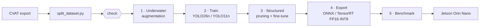
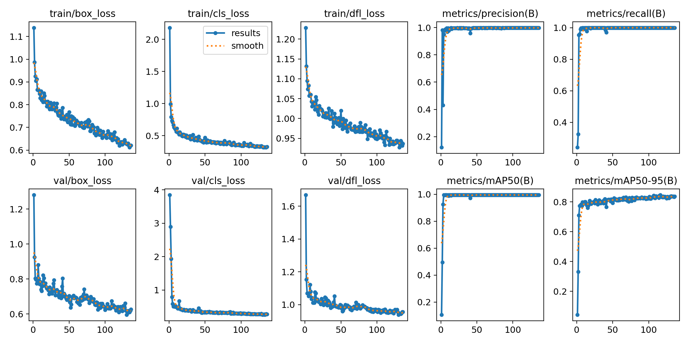
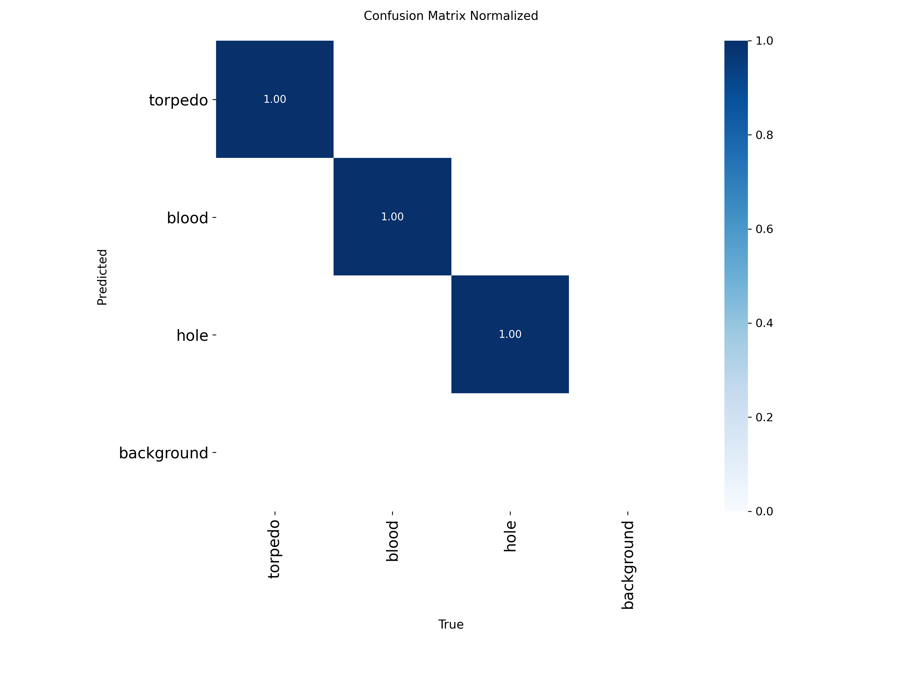
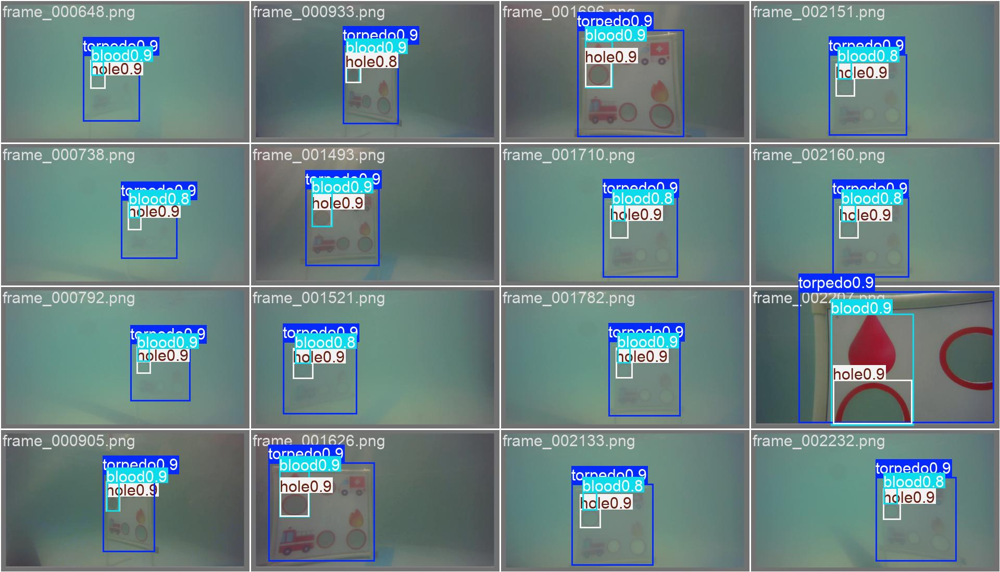

# BRACU Duburi · AUV Vision Pipeline

[](https://github.com/MadLad10/Testing-yolo26/actions/workflows/ci.yml)


Real-time object detection for the BRACU Duburi AUV (RoboSub). The pipeline takes a labelled
CVAT export to a pruned, TensorRT-compiled YOLO model running on a **Jetson Orin Nano 8 GB**,
with augmentation designed around how underwater images actually form.



Every stage is one subcommand of a single CLI, driven by YAML configs:

```bash
python -m auv_pipeline presets                 # list training presets + augment profiles
python -m auv_pipeline check     --data data.yaml
python -m auv_pipeline augment   --profile physics --images dataset/images/train
python -m auv_pipeline train     --data data.yaml --preset yolo26n --augment physics
python -m auv_pipeline prune     --weights best.pt --data data.yaml --ratio 0.3
python -m auv_pipeline export    --weights pruned.pt --formats engine --int8 --data data.yaml
python -m auv_pipeline benchmark --models best.pt pruned.pt --data data.yaml
python -m auv_pipeline run       --data data.yaml --preset yolo26n   # all of the above
```

---

## Stage 1 — Underwater augmentation

Stock augmentations (HSV jitter, brightness/contrast) treat underwater frames like ordinary
photos. Underwater images follow an image-formation model instead:

$$I_c = \underbrace{J_c\, e^{-\beta_c d}}_{\text{direct signal}} + \underbrace{B_c\,(1 - e^{-\beta_c d})}_{\text{backscatter}}$$

where *J* is the scene, *d* the range, *β<sub>c</sub>* the per-channel attenuation (red is
absorbed first) and *B<sub>c</sub>* the veiling light. [`auv_pipeline/augment/underwater.py`](auv_pipeline/augment/underwater.py)
implements each term as an Albumentations transform:

| Transform | What it simulates |
|---|---|
| `WaterAttenuation` | Wavelength-dependent absorption (Beer–Lambert) for clear / coastal / turbid water, with auto-exposure |
| `Backscatter` | Patchy veiling light / turbidity: `I = J·t + B·(1 − t)` with a smooth transmission map |
| `Caustics` | Rippling sunlight networks on pool floors and props in shallow water |
| `LightFalloff` | Uneven artificial lighting: a bright cone from the vehicle's lights, dark corners |
| `MarineSnow` | Suspended particles lit by the vehicle's lights |

They're combined with motion blur, low-light sensor noise and stream compression in the
**`physics`** profile:


*Top rows: each transform on its own. Bottom rows: the full profile at its training
probabilities, which is what the model actually sees.*

Profiles live in [`configs/augment/underwater.yaml`](configs/augment/underwater.yaml):

| Profile | Use |
|---|---|
| `physics` | Physically-based underwater formation (above) |
| `strong` | Heavy colour + lighting jitter (the original yolo26n recipe) |
| `blur` | Heavy colour jitter + motion/particulate blur (yolo26m recipe) |
| `light` | Mild jitter for clear, well-lit water (yolo11n recipe) |
| `none` | Ultralytics defaults: the baseline for ablations |

The transforms go to Ultralytics through its native `augmentations=` argument, with no
monkey-patching. They are pixel-level only (boxes untouched) and reproducible from a seed.

## Stage 2 — Training

Presets in [`configs/train/`](configs/train/) inherit shared defaults from `_base.yaml`:

| Preset | Model | Augment | Notes |
|---|---|---|---|
| `yolo26n` | YOLO26n | `strong` | Jetson target: 30+ FPS with TensorRT FP16 at 640 px |
| `yolo26m` | YOLO26m | `blur` | Accuracy ceiling; starting point for prune-to-nano |
| `yolo11n` | YOLO11n | `light` | Flips off |

```bash
python -m auv_pipeline train --data data.yaml --preset yolo26n --dry-run   # validate first
python -m auv_pipeline train --data data.yaml --preset yolo26n --augment physics --epochs 150
python -m auv_pipeline train --data data.yaml --preset yolo11n --hyp runs/tune/.../best_hyperparameters.yaml
python -m auv_pipeline train --resume runs/train/yolo26n_custom/weights/last.pt
```

Any Ultralytics argument can be overridden with `--set key=value` (for example `--set mosaic=0.5 cos_lr=true`).
Priority is `_base` < preset < augment profile < `--hyp` < CLI flags < `--set`.

Each run:
1. **Checks the dataset** before using the GPU: missing labels, out-of-range class ids, malformed boxes, empty classes, per-class instance counts.
2. Trains, then evaluates `best.pt` on the held-out **test** split.
3. Exports ONNX / TensorRT (TensorRT is skipped automatically when no CUDA device is available).
4. Writes `run_summary.json` with the config, git commit, val/test metrics and export paths.

## Stage 3 — Structured pruning

Removes whole channels (Torch-Pruning, BN-scale importance) so the network is genuinely
smaller on TensorRT, then fine-tunes to recover accuracy:

```bash
# single shot: yolo26n, 30 % of channels
python -m auv_pipeline prune --weights best.pt --data data.yaml --ratio 0.3 --finetune-epochs 25

# iterative: yolo26m -> nano-sized, 2 rounds x 40 %
python -m auv_pipeline prune --weights yolo26m_best.pt --data data.yaml --rounds 2 --ratio 0.4 --finetune-epochs 20
```

> **Pruning fix.** Ultralytics' `model.train()` rebuilds the network from its original YAML
> and copies over only the shape-matching weights. With the old scripts, the "pruned" model
> was silently rebuilt at full size for fine-tuning. The pipeline now fine-tunes the pruned
> module itself through a custom trainer, and warns if the parameter count ever grows back.

## Stage 4 — Export for the Jetson

```bash
python -m auv_pipeline export --weights best.pt --formats onnx engine          # FP16
python -m auv_pipeline export --weights best.pt --formats engine --int8 --data data.yaml   # INT8, calibrated
```

TensorRT engines are tied to the TensorRT version that built them, so **build the `engine`
on the Jetson** (or on a host with the same JetPack TensorRT).

## Stage 5 — Benchmark

```bash
python -m auv_pipeline benchmark --models best.pt pruned.pt pruned.engine \
    --labels base pruned trt --data data.yaml --save benchmark.md
```

Reports mAP50, mAP50-95, params, GMACs, file size, latency and FPS. The first model is the
reference and the other columns show deltas, with accuracy drops flagged.

---

## Results

Torpedo detector from the RoboSub runs: YOLO11n at 640 px, trained with the previous
training script (the dataset isn't in this repo). Full artefacts are in
[`saved_runs/Torpedo/`](saved_runs/Torpedo/).

| Metric | Value |
|---|---|
| Precision | 0.997 |
| Recall | 1.000 |
| mAP50 | 0.995 |
| mAP50-95 | 0.846 |
| Best epoch / epochs run | 116 / 136 (early stopped) |
| Train time | 6.1 min |

Regenerate this table with `python -m auv_pipeline report saved_runs/Torpedo --markdown`.

| Training curves | Confusion matrix |
|---|---|
|  |  |



---

## Setup

```bash
python3 -m venv .venv && source .venv/bin/activate
pip install torch torchvision --index-url https://download.pytorch.org/whl/cu121   # match your CUDA
pip install -r requirements.txt
pytest                                                                              # sanity check
```

### Data preparation

1. CVAT → **Export dataset** → format **YOLO 1.1**, then unzip.
2. Split and generate `data.yaml`:
   ```bash
   python split_dataset.py --input /path/to/cvat_export --output /path/to/dataset   # 85 / 5 / 10
   python -m auv_pipeline check --data /path/to/dataset/data.yaml
   ```
   `split_video.py` pulls frames from a video for annotation, and `prepare_dataset.py` merges several CVAT exports.

### Jetson Orin Nano deployment

1. Flash **JetPack 6.x** with NVIDIA SDK Manager.
2. Install NVIDIA's Jetson PyTorch wheel (not PyPI's), then `pip3 install torchvision ultralytics`.
3. Copy the pruned `best.pt` over and build the engine on the device:
   ```bash
   python3 -m auv_pipeline export --weights best.pt --formats engine          # or --int8 --data data.yaml
   ```
4. Run it:
   ```python
   from ultralytics import YOLO
   model = YOLO("best.engine")
   for frame in camera_stream():
       results = model(frame, imgsz=640, conf=0.4, iou=0.5)
   ```
   If 640 px is too slow even after pruning, use `imgsz=416` or `320`. INT8 gives roughly another 2× over FP16.

## Repository layout

```
auv_pipeline/            the staged pipeline (python -m auv_pipeline <stage>)
  augment/underwater.py    physics-based underwater transforms
  augment/preview.py       augmentation preview grids
  dataset.py               data.yaml / label sanity checks
  train.py  prune.py  export.py  benchmark.py  results.py  cli.py
configs/
  augment/underwater.yaml  augmentation profiles
  train/*.yaml             training presets
saved_runs/              results from previous runs
tests/                   unit tests (no GPU needed), run in CI
split_dataset.py  prepare_dataset.py  split_video.py  tune_yolo.py      data + tuning tools
infer_auv.py  navigate*.py  visual_navigation                           on-vehicle inference / navigation
dashboard.py  pipeline.py  n8n_workflow.json                            dashboard + annotation automation
```

## Troubleshooting

| Symptom | Fix |
|---|---|
| `check` reports malformed label lines | A class id is outside `names`, or there are fewer than 4 coordinates / coordinates outside [0, 1]. Fix the export or `names:` |
| TensorRT export skipped | There's no CUDA device on this machine. Build the engine on the Jetson (Stage 4) |
| mAP drops more than 4 points after pruning | Raise `--finetune-epochs`, lower `--ratio`, or prune iteratively with `--rounds` |
| OOM during training | Halve `--batch`, or try `--imgsz 416` |
